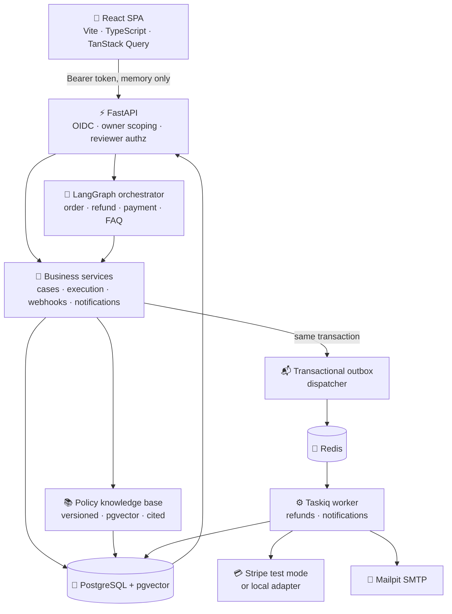
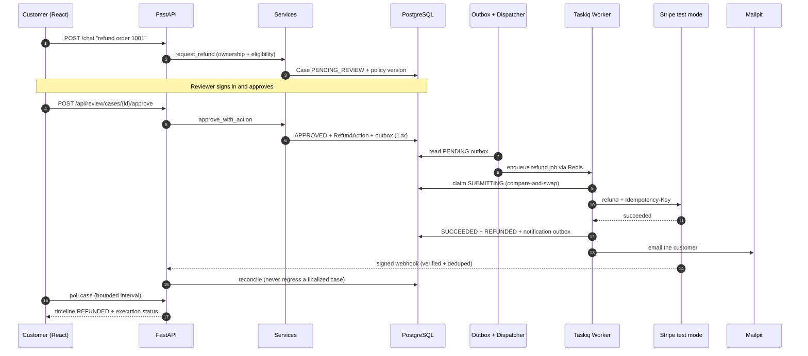
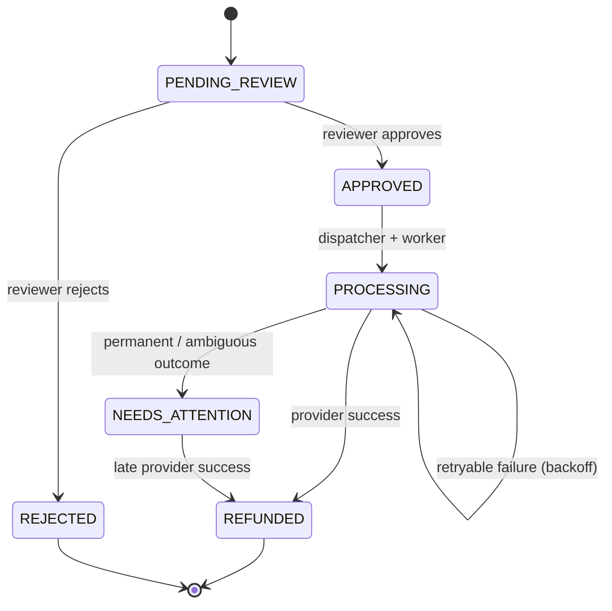

<div align="center">

# 🛟 Commerce Support AI

**A multi-agent customer-support platform that chats, reviews, refunds, and proves it — end to end.**


[**Quick start**](#quick-start) · [**Architecture**](#architecture) · [**Demo**](#take-it-for-a-spin) · [**Testing**](#testing) · [**Configuration**](#configuration)

</div>

---

## The 30-second story

A customer opens the React app, signs in with Keycloak, and asks *“I want a refund for order 1001.”*
The agent checks **their** order, confirms it is delivered, and files a refund request — it never touches money.
A reviewer signs in, sees the request in a queue, and approves it with a reason.
That approval atomically creates **one** refund action and an outbox record. A dispatcher hands the job to a
Taskiq worker, which calls **Stripe test mode** with a stable idempotency key. Stripe’s signed webhook and the
worker’s own result are reconciled — and the customer’s case timeline flips to **Refunded**, with a Mailpit email
on the way.

Everyone gets exactly one refund. Even if the worker crashes mid-flight. Even if Stripe sends the same webhook twice.
Even if two reviewers click *Approve* at the same moment.

> 💡 And when the customer asks a policy question, the FAQ agent answers from a **versioned, pgvector-backed policy
> knowledge base** and shows the exact document, version, and source it used.

---

## ✨ What's inside

| | Capability | What it actually does |
|---|------------|------------------------|
| 💬 | **Multi-agent chat** | LangGraph routes to order / refund / payment / FAQ specialists; DeepSeek V4.1 Flash drives tool-calling. |
| 🔐 | **Real auth** | Keycloak OIDC with Authorization Code + PKCE; issuer, audience, signature, and expiry validated in FastAPI. |
| 👤 | **Customer isolation** | Orders, payments, conversations, cases, and chat data are owner-scoped end to end — the model can’t argue its way into someone else’s order. |
| 🧑‍💼 | **Reviewer workflow** | Staff-only queue, filters, pagination, approve/reject with a reason, and a full audit trail. |
| 💳 | **Sandbox refunds** | Reviewer-approved refunds execute via a payment adapter (Stripe test mode or a deterministic local adapter). |
| 🔁 | **Reliability** | Transactional outbox, Taskiq/Redis workers, stable idempotency keys, reconciliation, `NEEDS_ATTENTION` recovery. |
| 🧾 | **Trusted webhooks** | Raw-body signature verification, event-id deduplication, amount/currency/payment validation, no state regression. |
| 📮 | **Customer notifications** | Durable notification rows + outbox, delivered over SMTP to Mailpit locally. |
| 📚 | **Policy KB with citations** | Versioned store policies, pgvector embeddings, active-version selection, structured citations in chat. |
| 🖥️ | **Polished React UI** | Vite + strict TypeScript + Router + TanStack Query; citations, case timeline, bounded polling, accessible states. |
| 🧪 | **128 automated tests** | 111 backend + 17 frontend, plus a Playwright customer→reviewer flow. |

---

## Architecture



### The refund lifecycle, step by step



### Case state machine



---

## Quick start

> **You’ll need:** Python 3.11+ (tested on 3.12), Node 20+, npm, and Docker.

```powershell
# 1. Infrastructure — PostgreSQL+pgvector, Redis, Mailpit, Keycloak
docker compose up -d

# 2. Python environment
python -m venv .venv
.\.venv\Scripts\Activate.ps1
.\.venv\Scripts\python.exe -m pip install -r requirements.txt

# 3. Configure (do NOT overwrite an existing .env)
Copy-Item .env.example .env   # add DEEPSEEK_API_KEY; keep PAYMENT_PROVIDER=local for the deterministic demo

# 4. Schema, demo data, policies
.\.venv\Scripts\python.exe -m alembic upgrade head
.\.venv\Scripts\python.exe -m src.backend.seed
.\.venv\Scripts\python.exe -m src.knowledge.ingest
```

Then open four terminals:

```powershell
# Terminal 1 — API
.\.venv\Scripts\python.exe -m uvicorn api:app --reload

# Terminal 2 — outbox dispatcher
.\.venv\Scripts\python.exe -m src.tasks.dispatch --loop

# Terminal 3 — Taskiq worker
.\.venv\Scripts\taskiq.exe worker src.tasks.broker:broker src.tasks.refund_tasks

# Terminal 4 — React app
cd frontend
npm install
npm run dev
```

| Service | URL |
|---------|-----|
| 💬 React app | **http://localhost:5173** |
| ⚡ API docs | http://localhost:8000/docs |
| 📮 Mailpit inbox | http://localhost:8025 |
| 🔐 Keycloak admin | http://localhost:8080 (admin / admin) |

> **pgvector note:** Phase 2 needs the `pgvector/pgvector:pg16` image (the bundled compose file). If your
> `pgdata` volume came from a plain `postgres` image, install the `vector` extension in that database or recreate
> the **dev** volume with `docker compose down -v` (that deletes local demo data only).

---

## Demo accounts

Keycloak realm `support`, client `commerce-support-web`. Password for everyone: **`password`**.

| User | Role | Owns |
|------|------|------|
| `alice@example.com` | 🛍️ Customer | Order 1001 (delivered, refund-eligible), 1002 (shipped), 1003 (placed) |
| `bob@example.com` | 🛍️ Customer | Order 1004 (delivered, eligible), 1005 (cancelled), 1006 (delivered) |
| `reviewer@example.com` | 🧑‍💼 Reviewer | Staff queue — no orders |

> Try asking alice for a refund on **1002** (shipped) — the business rule says no, and it says so politely.

---

## Take it for a spin

A 3-minute tour that shows off the whole loop:

1. **Ask a policy question** — sign in as **alice**, type *“How long does shipping take?”*. The reply includes a
   citation card with the policy title, version, and source. 🎯
2. **Request a refund** — type *“I want a refund for order 1001, it arrived broken.”* Then open **My cases** and
   see it sitting in **Pending review**.
3. **Review it** — sign out, sign in as **reviewer**, open **Review queue**, approve with a reason.
4. **Watch it land** — sign back in as **alice** and open the case. The timeline advances
   **Approved → Processing → Refunded**, and the reviewer page shows the execution action, attempts, and delivery records.
5. **Check the inbox** — http://localhost:8025 shows the “refund completed” email.
6. **Peek under the hood** — open the reviewer case detail to see the outbox/recovery status and the idempotency key.

Prefer the API? This one-liner shows citations without touching the UI:

```powershell
$body = @{ message = "How long does shipping take?" } | ConvertTo-Json
Invoke-RestMethod -Method Post -Uri "http://127.0.0.1:8000/chat" -ContentType "application/json" -Body $body |
  Select-Object reply, citations
```

---

## Configuration

All settings live in `.env` (copy from `.env.example`). Public frontend config is `VITE_*` only — no secrets.

| Variable | Default | Why it matters |
|----------|---------|----------------|
| `DEEPSEEK_API_KEY` | — | DeepSeek chat key (required for live chat) |
| `DEEPSEEK_MODEL` | `deepseek-flash` | Chat model id |
| `DATABASE_URL` | compose Postgres | SQLAlchemy URL (falls back to `SUPPORT_AGENT_DB_URL`, then SQLite) |
| `OIDC_ISSUER` / `OIDC_AUDIENCE` / `OIDC_CLIENT_ID` | local Keycloak realm | Token validation |
| `OIDC_REVIEWER_ROLE` | `reviewer` | Realm role that grants staff access |
| `PAYMENT_PROVIDER` | `local` | `local` (deterministic) or `stripe` (test mode) |
| `STRIPE_SECRET_KEY` | — | Stripe **test** secret (`sk_test_...`) |
| `STRIPE_WEBHOOK_SECRET` | — | Stripe webhook signing secret (`whsec_...`) |
| `REDIS_URL` | `redis://localhost:6379/0` | Taskiq broker |
| `EMAIL_TRANSPORT` | `memory` | `smtp` for Mailpit, `memory` for tests |
| `SMTP_HOST` / `SMTP_PORT` / `SMTP_SENDER` | `localhost` / `1025` / no-reply | Mailpit delivery |
| `EMBEDDING_PROVIDER` | `hashing` | `hashing` (offline) or `openai` |
| `EMBEDDING_DIM` | `384` | Must match the embedding model and vector column |

---

## Payments: Stripe test mode

The concrete sandbox integration talks to the **Stripe HTTP API** directly (no SDK), sending a stable
`Idempotency-Key: refund-case-<id>` so retries never double-refund. Amount, currency, and payment reference always
come from trusted backend rows — never from the model.

<details>
<summary><strong>Set up the Stripe sandbox (click to expand)</strong></summary>

1. Create a Stripe account and stay in **test mode**.
2. Put the test secret key (`sk_test_...`) in `STRIPE_SECRET_KEY`.
3. Provision a synthetic test payment for the demo order:
   ```powershell
   $env:STRIPE_SECRET_KEY = "sk_test_..."
   .\.venv\Scripts\python.exe scripts\stripe_provision.py --order 1001
   ```
   This creates a confirmed test PaymentIntent and points order 1001’s payment row at it (`provider=stripe`).
4. Forward webhooks and copy the printed signing secret into `STRIPE_WEBHOOK_SECRET` (`whsec_...`):
   ```powershell
   stripe listen --forward-to http://localhost:8000/api/webhooks/stripe
   ```
5. Set `PAYMENT_PROVIDER=stripe`, then restart the API and worker.

> No Stripe key? No problem. Keep `PAYMENT_PROVIDER=local` and the deterministic local adapter runs the entire flow
> in-process — perfect for tests and offline demos.

</details>

---

## Reliability, in plain English

- 🧾 **One transaction, zero drift** — approval writes the case transition, the single `RefundAction` (unique
  `case_id`), and the outbox row together.
- 🔑 **One refund, ever** — a per-case idempotency key is reused on every retry.
- 🧵 **Duplicate jobs are boring** — a compare-and-swap claim makes a second delivery a no-op.
- 🧭 **Three kinds of failure** — retryable (backoff + requeue), permanent (`NEEDS_ATTENTION`), and uncertain
  (reconcile with the provider before resubmitting; unresolved → `NEEDS_ATTENTION`).
- 💥 **Crash after the provider accepted?** The action stays `SUBMITTING`; stale recovery re-enqueues it and the
  worker reconciles the provider result instead of charging again.
- 📬 **Outbox never forgets** — nothing is deleted on dispatch; `PENDING` rows are retried with backoff, and a
  `FAILED` ceiling stops runaway loops.

---

## Webhooks

`POST /api/webhooks/stripe` verifies the `Stripe-Signature` HMAC over the **raw request body** (with a timestamp
tolerance), deduplicates `(provider, event_id)`, and validates the provider, payment reference, amount, and currency
against the stored action before applying anything. Late, duplicate, and out-of-order events are acknowledged without
regressing a finalized case — and a late success can still rescue a `NEEDS_ATTENTION` case.

---

## Notifications

Each case update creates a durable `Notification` row plus an outbox event; the notification worker sends it over SMTP.
Locally, Mailpit catches everything at **http://localhost:8025**. Delivery is **at-least-once**: a status CAS stops
duplicate sends on retry, and SMTP has no provider idempotency, so a crash after acceptance but before the local
`SENT` commit can resend — documented, deliberate, and safe.

---

## Policy knowledge base

- 📄 `policy_documents` (store, topic, title, version, effective date, source, content, active) +
  `policy_chunks` (chunk index, text, vector).
- 🧠 **Embeddings are separate from DeepSeek chat.** Default `hashing` embedder is deterministic, offline, and
  **384-dimensional**. For a real model: `EMBEDDING_PROVIDER=openai`, `EMBEDDING_MODEL=text-embedding-3-small`,
  `EMBEDDING_DIM=1536`, plus `EMBEDDING_BASE_URL` / `EMBEDDING_API_KEY`.
- 🔁 **Repeatable ingestion:**
  ```powershell
  .\.venv\Scripts\python.exe -m src.knowledge.ingest
  .\.venv\Scripts\python.exe -m src.knowledge.ingest --reindex   # force re-embedding
  ```
- 📌 Only the highest **effective** version per `(store, topic)` is active. Citations carry document id, title,
  version, source, effective date, chunk index, snippet, and score.
- 🛡️ Retrieved text is **untrusted content**: it informs answers, never eligibility (that stays a business rule), and
  the active refund policy version is recorded on every case.

---

## API at a glance

| Method | Path | Auth | Purpose |
|--------|------|------|---------|
| `GET` | `/health` | — | Liveness |
| `GET` | `/api/auth/config` | — | Public OIDC config (PKCE) |
| `GET` | `/api/me` | any | Current identity |
| `POST` | `/chat` | any | Chat (owner-scoped; returns `citations`) |
| `GET` | `/api/orders` | any | Your orders |
| `GET` | `/api/conversations` · `/{id}` | any | Your conversations |
| `GET` | `/api/cases` · `/{id}` | any | Your cases + timeline + `execution_status` |
| `GET` | `/api/review/cases` | reviewer | Queue (pagination + filters) |
| `GET` | `/api/review/cases/{id}` | reviewer | Case + `action`, `notifications`, `outbox` |
| `POST` | `/api/review/cases/{id}/approve` | reviewer | Approve (creates action + outbox) |
| `POST` | `/api/review/cases/{id}/reject` | reviewer | Reject (reason required) |
| `POST` | `/api/webhooks/stripe` | signature | Provider webhook reconciliation |

---

## Project layout

```text
commerce-support-ai/
├── api.py                      # FastAPI entry point
├── docker-compose.yml          # PostgreSQL+pgvector · Redis · Mailpit · Keycloak
├── migrations/                 # Alembic (0001 schema, 0002 Phase 2)
├── keycloak/                   # realm export with demo users
├── scripts/                    # OpenAPI dump · Stripe provisioning
├── src/
│   ├── api/                    # routes, auth, deps, schemas, serializers
│   ├── agents/                 # order · refund · payment · FAQ specialists
│   ├── backend/                # models, db, seed, vector type
│   ├── integrations/           # commerce, payments (local + Stripe), email
│   ├── knowledge/              # embeddings, policies, ingestion
│   ├── outbox/                 # dispatcher
│   ├── services/               # cases, refund execution, webhooks, notifications
│   ├── tasks/                  # Taskiq broker, workers, dispatch CLI
│   ├── orchestrator.py         # LangGraph graph
│   └── tools.py                # agent tools (owner-scoped)
├── tests/                      # 111 deterministic backend tests
└── frontend/                   # React app (Vite + strict TS)
    ├── src/api/                # typed client + generated OpenAPI types
    ├── src/auth/               # OIDC + PKCE
    ├── src/features/           # auth · chat · cases · review
    └── e2e/                    # Playwright customer→reviewer flow
```

---

## Testing

<details open>
<summary><strong>Backend — 111 deterministic tests</strong></summary>

```powershell
.\.venv\Scripts\python.exe -m pytest -q
```

Covers duplicate jobs, concurrent approval, worker crash after provider acceptance, outbox retry/recovery, invalid
webhook signatures, delayed/out-of-order events, amount/currency mismatches, uncertain outcomes, notification retries,
active policy selection, citations, cross-user access, expired tokens, and reviewer permissions.

</details>

<details open>
<summary><strong>Frontend — 17 tests + typecheck + build</strong></summary>

```powershell
cd frontend
npm run typecheck
npm run lint
npm test
npm run build
```

Component tests cover status labels, bounded polling, the case timeline, and policy citation rendering.

</details>

<details>
<summary><strong>Live end-to-end (Playwright)</strong></summary>

Requires the full stack (Docker + backend + dispatcher + worker + frontend):

```powershell
npx playwright install chromium
npm run test:e2e
```

The flow asks a policy question (citations visible), requests a refund, has the reviewer approve it, then watches the
customer timeline reach **Refunded**.

</details>

> **Deterministic vs live:** everything above except the Playwright flow runs without network access, a Stripe key,
> or Docker. The Playwright flow and Stripe sandbox are the “live” checks.

---

## Troubleshooting

<details>
<summary><strong>“extension vector is not available”</strong></summary>

Your PostgreSQL doesn’t have pgvector. Use the bundled `pgvector/pgvector:pg16` image. If an old plain-Postgres
volume exists, install the `vector` extension or recreate the **dev** volume with `docker compose down -v`
(deletes local demo data only).
</details>

<details>
<summary><strong>Refund stays on “Approved”</strong></summary>

The dispatcher and/or worker isn’t running. Start `python -m src.tasks.dispatch --loop` and the Taskiq worker, and
make sure `REDIS_URL` points at the running Redis container.
</details>

<details>
<summary><strong>Email never arrives</strong></summary>

Set `EMAIL_TRANSPORT=smtp` (the default is `memory`), confirm Mailpit is up, then check http://localhost:8025.
</details>

<details>
<summary><strong>Chat has no citations</strong></summary>

Run `python -m src.knowledge.ingest` and set `DEEPSEEK_API_KEY`. Missing evidence falls back gracefully to static
guidance with no citations.
</details>

<details>
<summary><strong>Taskiq can’t reach Redis</strong></summary>

Confirm `docker compose ps` shows Redis healthy and `REDIS_URL=redis://localhost:6379/0` is set (the worker loads
`.env` automatically).
</details>

---

## Security notes

- 🔒 Access tokens live **in memory only** — never in URLs or persistent storage.
- 🧾 Identity and role come from validated OIDC claims — never from model output or request bodies.
- 🙈 Customer responses redact tool internals and provider error bodies; execution details sit behind reviewer auth.
- ✍️ Webhook signatures are verified over the raw body; event ids are deduplicated.
- 🤫 Keep `DEEPSEEK_API_KEY`, `STRIPE_SECRET_KEY`, and `STRIPE_WEBHOOK_SECRET` out of Git. `.env` is git-ignored and
  no secrets are logged.

---

<div align="center">

**Built with ❤️ using FastAPI, LangGraph, PostgreSQL + pgvector, Keycloak, Taskiq, and React.**

*Questions, ideas, or a bug? Open an issue — happy to help.*

</div>
